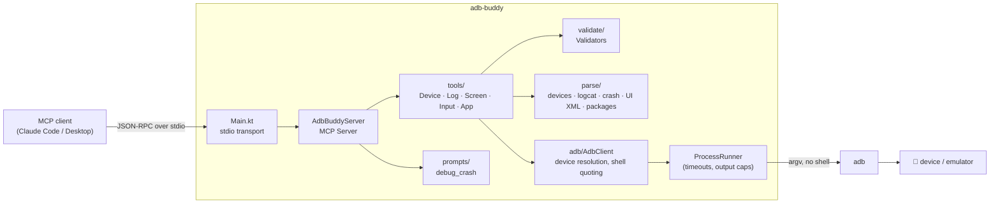

# adb-buddy

[](https://github.com/ezanetta/adb-buddy-mcp/actions/workflows/build.yml)
[](LICENSE)

**An MCP server that lets Claude (or any MCP client) see, debug and drive your Android devices and emulators through adb.**

Ask *"why did my app just crash?"* and the assistant reads the stack trace, looks at the screen and
explains the cause, without you copying logs around. Written in Kotlin on the official
[MCP Kotlin SDK](https://github.com/modelcontextprotocol/kotlin-sdk), shipped as a single JAR.

<!-- Demo GIFs: record with the emulator side by side with Claude, then replace the placeholders. -->
| Debugging a crash | Driving the UI |
| --- | --- |
|  |  |

## Features

| Tool | What it does | Kind |
| --- | --- | --- |
| `list_devices` | Serial, model, Android version, emulator or physical | read only |
| `get_logcat` | Recent logs filtered by tag, minimum level and/or app package | read only |
| `get_crash_log` | Latest Java crash, native crash (tombstone) or ANR for a package | read only |
| `take_screenshot` | Screen as an MCP image, downscaled to save tokens, with the scale factor for taps | read only |
| `dump_ui_hierarchy` | Visible elements as compact lines: text, id, state, tap coordinates | read only |
| `list_packages` | Installed third-party apps, optional filter | read only |
| `get_current_activity` | Foreground package and activity | read only |
| `launch_app` | Start an app through its launcher activity | action |
| `tap` / `swipe` | Touch input, validated against the current screen size | action |
| `input_text` | Type into the focused field, safely escaped | action |
| `press_key` | `BACK`, `HOME`, `ENTER`, `APP_SWITCH`, `VOLUME_UP`, `VOLUME_DOWN` | action |
| `install_apk` | Install or update from a local `.apk` (debug builds allowed) | destructive |
| `clear_app_data` | Wipe an app's data (`pm clear`) | destructive |

Every tool takes an optional `serial`; it is only needed when more than one device is connected.
Tools carry MCP annotations (`readOnlyHint`, `destructiveHint`), so clients can auto-approve the
read-only ones and ask before the rest.

**Prompt:** `debug_crash(package)` walks the model through crash log → screenshot → UI hierarchy and
asks for the probable cause and a fix.

A UI dump of the Android Settings home screen, as the model sees it (29 KB of XML in, 12 lines out):

```text
Screen 1080x2424, rotation 0, app com.android.settings. 12 elements; (x,y) is the center to pass to tap.
[1] LinearLayout "Search Settings" id=search_action_bar clickable (540,257)
[2] ScrollView id=main_content_scrollable_container scrollable (540,1367)
[3] LinearLayout "Google | Services & preferences" clickable (540,485)
[4] LinearLayout "Network & internet | Mobile, Wi‑Fi, hotspot" clickable (540,719)
...
```

## Requirements

- JDK 17 or newer to run the JAR
- Android SDK platform-tools (`adb`). adb-buddy looks in `$ANDROID_HOME/platform-tools`, then
  `$ANDROID_SDK_ROOT/platform-tools`, then `PATH`.
- A device with USB debugging enabled, or a running emulator

## Build

```bash
./gradlew shadowJar          # → build/libs/adb-buddy.jar
./gradlew check              # unit tests + ktlint
```

The Gradle toolchain downloads JDK 17 if you don't have it. Prebuilt JARs are attached to every
[CI run](https://github.com/ezanetta/adb-buddy-mcp/actions/workflows/build.yml) as the `adb-buddy-jar` artifact.

## Setup

### Claude Code

```bash
claude mcp add adb-buddy -- java -jar /absolute/path/to/adb-buddy.jar
```

If `adb` is not on the `PATH` Claude Code sees, pass the SDK location:

```bash
claude mcp add adb-buddy -e ANDROID_HOME=$HOME/Library/Android/sdk -- java -jar /absolute/path/to/adb-buddy.jar
```

### Claude Desktop

Add to `claude_desktop_config.json` (macOS: `~/Library/Application Support/Claude/`,
Windows: `%APPDATA%\Claude\`), then restart Claude Desktop:

```json
{
  "mcpServers": {
    "adb-buddy": {
      "command": "java",
      "args": ["-jar", "/absolute/path/to/adb-buddy.jar"],
      "env": {
        "ANDROID_HOME": "/Users/you/Library/Android/sdk"
      }
    }
  }
}
```

Desktop apps don't inherit your shell's `PATH`, so set `ANDROID_HOME` (and use a full path to
`java` if it isn't found).

## Example prompts

- "Which devices are connected?"
- "My app `com.example.shop` just crashed. What happened?" (or run the `debug_crash` prompt)
- "Show me the warnings from OkHttp in the last 200 log lines."
- "Open Settings, go to Display and turn on dark theme."
- "Log in to the app with test@example.com / hunter2 and tell me what the home screen shows."
- "Install `app/build/outputs/apk/debug/app-debug.apk`, launch it and take a screenshot."

## Safety

adb can do anything to a device, so adb-buddy deliberately exposes a narrow surface:

- **No generic shell tool.** Each tool runs a fixed adb command; the model only fills in validated values.
- **No host shell.** adb is started with `ProcessBuilder` argument lists, never a command string.
- **Device shell quoting.** `adb shell` joins its arguments into a string that the *device's* `sh`
  parses, so every argument is single-quoted. Typing `"; reboot` into a text field types exactly that.
- **Validation before execution.** Package names are checked against a strict pattern, keys against an
  allowlist, tap and swipe coordinates against the current screen size (rotation and `wm size`
  overrides included), APK paths for existence, extension and zip signature.
- **Bounded work.** Every command has a timeout; output is capped and truncation is stated in the result.
- **Errors are results.** Problems come back as `isError` tool results with an actionable message
  (e.g. listing the connected devices when `serial` is ambiguous), never as stack traces.
- **Untrusted XML.** UI dumps are parsed with DTDs disabled (no XXE).
- **Annotations.** `clear_app_data` and `install_apk` are marked destructive. Keep them behind a
  confirmation in your client.

Logging goes to stderr only; stdout is reserved for the MCP protocol.

## Architecture



| Path | Responsibility |
| --- | --- |
| `adb/ProcessRunner.kt` | Runs a command as an argument list with timeout and output cap; a fake in tests |
| `adb/AdbLocator.kt` | Finds adb from `ANDROID_HOME`, `ANDROID_SDK_ROOT` or `PATH` |
| `adb/AdbClient.kt` | Typed adb operations, device selection, device-shell quoting |
| `adb/AdbException.kt` | Every failure a client can see, with model-friendly messages |
| `parse/` | Pure parsers for adb output, tested against fixtures captured from a real emulator |
| `tools/` | One file per tool group; thin MCP adapters with schemas and annotations |
| `validate/Validators.kt` | Input validation and `input text` encoding |

## Testing

- **Unit tests** (JUnit 5 + Kotest assertions) cover every parser, against fixtures captured from
  an Android 17 emulator plus synthetic edge cases (interleaved crash logs, rotated screens,
  XXE payloads, injection attempts).
- **Tool tests** run the real MCP server against an in-memory MCP client, with adb replaced by a
  scripted fake that asserts the exact argument lists sent to adb.
- **Protocol checks** with the MCP Inspector CLI: `scripts/verify-inspector.sh` (add `--device` to
  call tools on a connected device). Results and the protocol-era matrix are in
  [docs/protocol-verification.md](docs/protocol-verification.md).

The server speaks every handshake-era protocol version (`2024-11-05` to `2025-11-25`). The
stateless `2026-07-28` era isn't available yet because the Kotlin SDK doesn't implement it;
see the roadmap.

## Roadmap

- [ ] Stateless MCP (`2026-07-28`) once the Kotlin SDK ships it ([kotlin-sdk#985](https://github.com/modelcontextprotocol/kotlin-sdk/pull/985))
- [ ] `structuredContent` + output schemas for `list_devices` and `dump_ui_hierarchy`
- [ ] More keys (`DEL`, `TAB`, `DPAD_*`) and a `long_press` tool
- [ ] `find_element` / `tap_element` by text or resource id, so the model doesn't need coordinates
- [ ] Unicode text input (via clipboard or an IME helper)
- [ ] Screen recording (`screenrecord`) returned as a resource
- [ ] Streamable HTTP transport for remote device farms
- [ ] Release workflow publishing the JAR to GitHub Releases

## License

[MIT](LICENSE)
